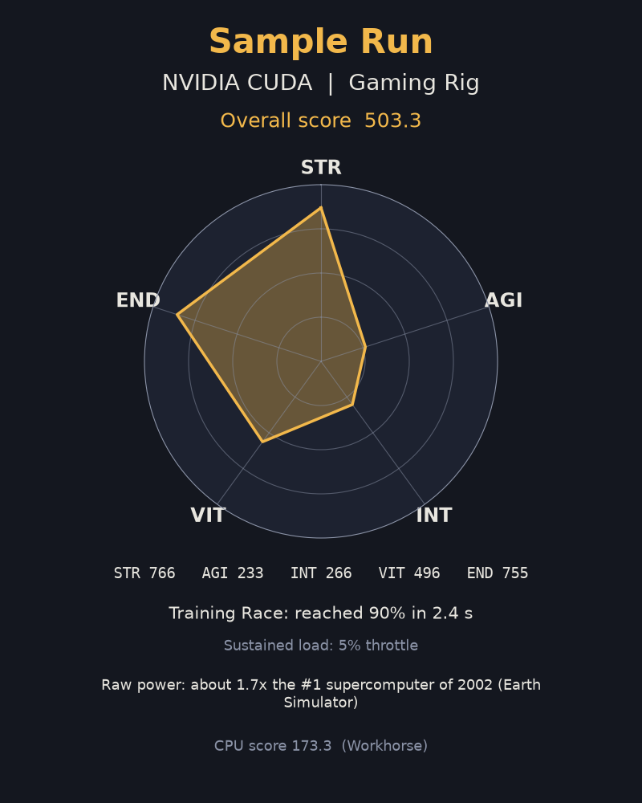

# RPG PyTorch Benchmark

Turn your computer into an RPG character. The benchmark measures five stats,
adds them up into a score and a tier, and runs a short "Training Race" where a
small neural network trains on synthetic data while a progress bar fills up.

This project benchmarks a PC with PyTorch and presents it as an RPG character
with five stats, a score and a tier. The Sample Run below scores 503.3 and
reaches the tier Gaming Rig.



Sample Run: Intel Core i9-14900K + RTX 5090

| Stat | What it measures |
|------|------------------|
| STR  | Raw matrix-math speed (fp32 GFLOPS) |
| AGI  | How fast a small model answers one request (latency) |
| INT  | Text generation speed of a small transformer (tokens per second) |
| VIT  | Memory copy bandwidth and the largest block of memory it can grab |
| END  | Sustained speed under a long load (do you throttle?) |

Tiers, from weakest to strongest: Potato, Toaster, Workhorse, Gaming Rig,
Mini Supercomputer. You also get a fun comparison with historic machines.

The benchmark runs fully offline after installation. It never uses the network
and it collects no hostname and no username (details at the end).

## 1. Install (pick the section that matches your PC)

You need Python and a terminal (PowerShell on Windows). Python 3.11 to 3.13
works for the CPU and NVIDIA setups. Open a terminal in the project folder
(the one that contains `bench.py`) and create a virtual environment:

```
python -m venv .venv
.venv\Scripts\activate
```

On Linux or macOS use `source .venv/bin/activate` instead of the second line.

### 1a. CPU only (works on every PC)

```
pip install torch --index-url https://download.pytorch.org/whl/cpu
pip install -r requirements.txt
```

`requirements.txt` installs matplotlib, which draws your character card.
`psutil` is optional: `pip install psutil` lets the benchmark check for
battery power and heavy background apps more precisely, but everything works
without it.

If you only have a CPU, you are done. Skip to section 2.

### 1b. AMD Radeon RX 7000 / RX 9000 series (ROCm on Windows)

AMD publishes official PyTorch wheels for these cards on Windows. This is the
route that gives real GPU scores on AMD hardware.

- Requirements: Windows 11, Python 3.12, and the current AMD Adrenalin driver
  that AMD lists as required for ROCm on Windows (install it first and reboot).
- The wheels are downloaded from `repo.radeon.com`. The exact file names,
  supported cards and driver versions change often, so follow AMD's page as
  the authoritative, current instructions:
  https://rocm.docs.amd.com/projects/radeon-ryzen/en/latest/docs/install/installrad/windows/install-pytorch.html
- Do the install in a Python 3.12 virtual environment, then also run
  `pip install -r requirements.txt`.

Check that PyTorch sees your GPU:

```
python -c "import torch; print(torch.cuda.is_available())"
```

It should print `True` (ROCm builds use the name "cuda" inside PyTorch). The
benchmark labels this device "AMD ROCm". If it prints `False`, see
Troubleshooting.

### 1c. AMD Radeon RX 6000 series (and other older cards): torch-directml

**RX 6000 owners (RX 6600, 6700 XT, 6800, ...): this is your section.** AMD's
official ROCm wheels for Windows do not cover RX 6000 cards, so use
`torch-directml`, which runs PyTorch on any DirectX 12 GPU (AMD, Intel or
NVIDIA).

**You need Python 3.12 (or 3.11). torch-directml has no wheels for
Python 3.13 or newer, so `pip install` fails there.** If you have several
Python versions installed, create the venv with the Windows launcher:

```
py -3.12 -m venv .venv
.venv\Scripts\activate
pip install torch-directml
pip install -r requirements.txt
```

Do not install `torch` separately first: torch-directml installs the PyTorch
version it needs (2.4.1) by itself.

Check that it sees your GPU:

```
python -c "import torch_directml as d; print(d.device_name(0))"
```

It should print your Radeon card's name. The benchmark labels this device
"DirectML". Things to know:

- It is slower than a native ROCm or CUDA build, so your GPU score is a
  floor, not your card's full potential.
- If some operation is unsupported, the benchmark marks the GPU as unscored
  with a warning and keeps your CPU results.

Whatever goes wrong on the GPU path, the benchmark falls back to the CPU: the
CPU is always benchmarked first, and a GPU problem only means you get no GPU
score (with a warning explaining why).

### 1d. NVIDIA GeForce / RTX (CUDA)

Use the official PyTorch CUDA wheel index. Pick the exact command for your
CUDA version on https://pytorch.org/get-started/locally/ ; it looks like:

```
pip install torch --index-url https://download.pytorch.org/whl/cu124
pip install -r requirements.txt
```

Check with `python -c "import torch; print(torch.cuda.is_available())"`. The
benchmark labels this device "NVIDIA CUDA".

## 2. Run it

Close heavy apps first (games, video editors, OBS, browsers with many tabs)
and plug in your charger. A laptop on battery gets throttled and your score
will be unfairly low. The benchmark warns you about both but never blocks you.

```
python bench.py
```

Options:

| Option | Meaning |
|--------|---------|
| `--name NICKNAME` | Your character name. If you leave it out you are asked; an empty answer means `player`. |
| `--quick` | A smoke test of about 30 seconds. Fine to check that everything works; use the full run for your real result. |
| `--cpu-only` | Skip GPU detection and only benchmark the CPU. Handy when the GPU setup misbehaves. |
| `--help` | Show all options. |

How long it takes:

- Full run on a CPU-only PC: about 3 to 5 minutes.
- Full run with a GPU: the GPU is benchmarked after the CPU, up to about
  8 minutes in total.
- Quick run: about 30 seconds.

Do not use the computer for other things while it runs, and do not worry if
the fans spin up: the END stat is meant to stress the machine for a while.
Press Ctrl+C to stop; nothing is saved for an interrupted run.

When a GPU is found it is scored separately from the CPU. If the GPU finishes
everything, your character card shows the GPU result and also lists the CPU
score.

## 3. Results (Sample Run)

This section shows one run, called the Sample Run. It is example output for a
PC with an Intel Core i9-14900K and an NVIDIA GeForce RTX 5090, using
the CUDA backend in full mode.

- Overall score: 503.3
- Tier: Gaming Rig
- STR 766, AGI 233, INT 266, VIT 496, END 755
- Training Race: reached 90% in 2.4 s
- CPU score 173.3 (Workhorse)

## 4. Data note

The Training Race uses synthetic data. It is generated at run time from a
fixed seed. No external dataset is downloaded or used. There is no separate
test set. The accuracy check uses validation samples that are generated
separately from the training samples, not copied out of them. So there is no
overlap between training and validation data to worry about.

## 5. What to send your instructor

When the run finishes, look in the `results` folder (next to `bench.py`).
Send the two files from your run, which share one name:

- `yourname_YYYYMMDD-HHMMSS.json` (the results)
- `yourname_YYYYMMDD-HHMMSS.png` (your character card)

If you run the benchmark more than once, send the files of the run you want
counted. Nothing is ever overwritten; a second run in the same second gets a
`-2` suffix.

## 6. For the instructor: building the leaderboard

Collect all the `.json` files in one folder, then run (standard library only,
no installs needed):

```
python leaderboard.py FOLDER
python leaderboard.py FOLDER -o class_board.html
python leaderboard.py FOLDER --include-quick
```

- The page is written to `leaderboard.html` in the current directory, or to
  the path given with `-o`.
- It is one self-contained file: open it in any browser, offline.
- There are separate CPU and GPU boards, ranked by score, with the spread
  between fastest and slowest, every stat and the Training Race result.
- Quick-mode runs are left out unless you pass `--include-quick`; the page says
  how many were left out.
- If a nickname appears in several files, only its best run is kept per board.
- Files that are not valid results (broken JSON, missing fields, a different
  schema version) are skipped with a warning naming the file.

## 7. Troubleshooting

- "PyTorch could not be imported": install torch first (section 1) inside the
  same virtual environment you run `bench.py` from. Remember to activate it
  (`.venv\Scripts\activate`).
- `torch.cuda.is_available()` prints `False` on an AMD or NVIDIA machine: the
  driver or the wheel does not match your card. Update the GPU driver, re-check
  AMD's or PyTorch's install page, and make sure you installed the GPU wheel
  and not the CPU one. You can still submit a CPU-only run with `--cpu-only`.
- `pip install torch-directml` says "no matching distribution": your venv uses
  Python 3.13 or newer. Delete `.venv` and recreate it with `py -3.12 -m venv
  .venv` (install Python 3.12 from python.org first if `py -3.12` is missing).
- The GPU is "unscored - see warnings": some operation failed on the GPU. The
  CPU result is still valid and is what the card shows.
- The score looks too low: you were probably on battery or had heavy apps open.
  Close them, plug in, and run again.
- "Character card not rendered": matplotlib is missing or failed. Run
  `pip install -r requirements.txt`. The JSON is still saved.
- The first run is slower to start: matplotlib builds its font cache once.
- "Could not write results": the `results` folder is not writable. Move the
  project to a normal folder such as your Documents folder.
- The text looks odd on an old console: all output is plain ASCII on purpose.

## 8. Limitations

- The reference baselines and the tier thresholds are design choices. They are
  not calibrated across many machines.
- Results from different backends (CUDA, ROCm, DirectML, MPS) are not strictly
  comparable.
- Results depend on your power settings, your thermals and background load.
- Quick-mode results are not comparable to full-mode results.

## 9. Privacy and offline use

- After you have installed the packages, the benchmark runs completely offline
  and makes no network calls.
- It collects no hostname and no username, and the results contain no file
  paths. The hardware information is limited to: CPU model, core counts, RAM,
  GPU name, PyTorch version, backend, Python version and OS version.
- Your nickname is stored exactly as you typed it (trimmed to 32 characters),
  so do not use your real name if you do not want it in the results.

## 10. Developer notes

Run the tests (no GPU needed; tests that need torch or matplotlib are skipped
when those are missing):

```
python -m pip install pytest pycodestyle vermin
python -m pytest -q
python -m pycodestyle --max-line-length=99 bench.py leaderboard.py rpgbench tests
vermin -t=3.10- --no-tips --violations bench.py leaderboard.py rpgbench tests
```

Layout: `bench.py` is the command line entry point, `leaderboard.py` is the
standalone report generator, and the `rpgbench/` package holds the scoring,
device detection, workloads, Training Race, result saving and card drawing.
